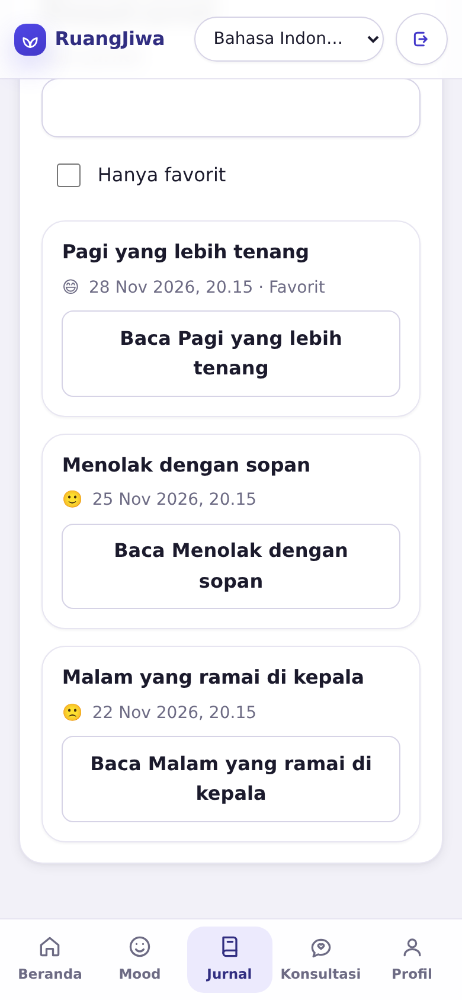
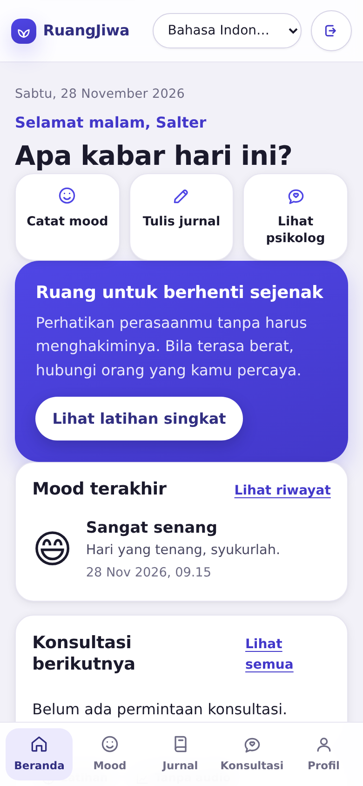
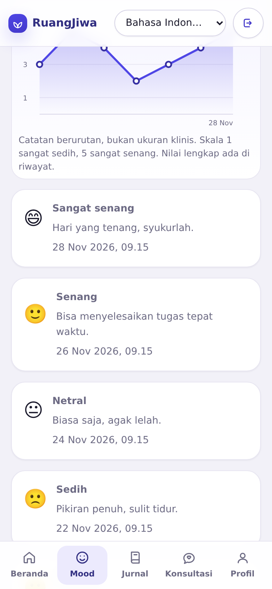
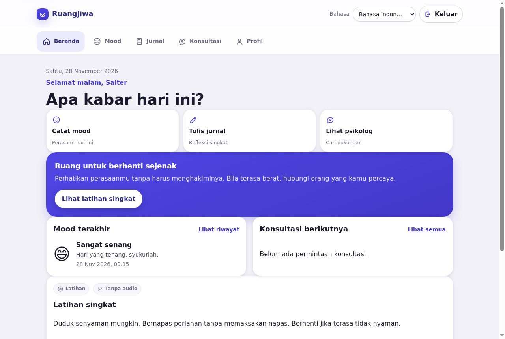

# RuangJiwa

**A private space to write it down.** RuangJiwa is an Indonesian journaling, mood tracking and reflection app built as an installable web PWA: one small bundle, mobile first, no tracking and no third-party analytics.

[](https://github.com/notsalter/RuangJiwa/actions/workflows/web-ci.yml)
[](LICENSE)
[](docs/SETUP.md)

**[Documentation](docs/README.md)** · [Setup and deployment](docs/SETUP.md) · [Migration record](docs/MIGRATION.md)



*Local build against the self-hosted API, with test entries written for the screenshot.*

| Home | Mood history |
| --- | --- |
|  |  |

On a tablet or desktop the tab bar moves to the top and the reading column widens:



## What it does

- **Sign in** with email and password, with a readonly account email and password reset.
- **Journal** with reflection prompts, moods, tags, favorites, search and an explicit delete confirmation.
- **Track mood** across five values and read a 14 day chart built from your own entries.
- **Reflect** with two short quizzes (stress and anxiety), scored and stored as history.
- **Find support**: a psychologist directory and future consultation requests you can cancel while they are still pending.
- **Remind yourself** by exporting an `.ics` calendar file for a mood check-in or a confirmed consultation.
- **Install it**: home screen install, an offline app shell, and update prompts that wait for your consent. An unsaved journal draft blocks reload.

Everything runs on one UI with two interchangeable data backends: Firebase (the default) or a self-hosted API you run yourself.

## How it works

```
Browser (Preact + TypeScript + Vite)
  ├─ five tab shell, base-aware History API routing
  ├─ Backend interface ──┬── Firebase Auth + Firestore Lite + Storage
  │                      └── HTTP adapter ──► self-hosted Hono API (server/)
  └─ service worker: static shell only, never private data
```

The client validates records before writing and after reading, but client validation is defense in depth. Access control belongs in Firestore and Storage rules, which are proposed in [FIREBASE_RULES.md](docs/FIREBASE_RULES.md) and are **not deployed**. The self-hosted adapter talks to Hono with an HTTP-only cookie session and no token in browser storage.

## Run it locally

Use Node.js 22 or later, from a reviewed checkout:

```sh
cd web
npm ci
cp .env.example .env      # add your Firebase web identifiers
npm run dev
```

Without complete Firebase configuration the app still opens, but login is visibly unavailable. There is no guest backend and no seeded account. The build works at `/` or under a subpath, for example `VITE_BASE_PATH=/RuangJiwa/`. Full detail, including the optional self-hosted API, is in [Setup and deployment](docs/SETUP.md).

## Tests

```sh
npm run check                  # typecheck, unit/component tests, dependency tests, build
npm run test:coverage
node --test tests/pwa.test.mjs # service worker, manifest and install policy
```

`npm run check` is the gate CI runs: 222 unit and component tests, 5 dependency compatibility tests, typecheck and a production build. Five PWA policy tests run separately and CI provisions a pinned Pillow for them. Tests use boundary mocks for the network and Firebase only; session state, validation, selectors and components execute real application code. No production backend connection is claimed.

## Privacy and data

- **Records are per user.** Journals, moods, quiz history and consultations are owner scoped; the psychologist directory is the only shared collection, and it holds no personal data.
- **Reminders are local.** Reminders export calendar files; there is no push subscription, no notification permission prompt and no background scheduler.
- **The offline shell is not an offline database.** The service worker caches static assets only, and private responses are never cached. Private records require an online authenticated session.
- **Avatars carry an accepted risk.** New uploads store an owned path and render through an authenticated blob read, but a Firebase download-token URL is readable by anyone holding it. That residual risk is documented in [AVATARS.md](docs/AVATARS.md) and is not a strict-private guarantee.
- **Keys stay out of the repository.** Firebase web identifiers are build-time client identifiers, not secrets; never commit a real `.env`.

## Documentation

| Document | Contents |
| --- | --- |
| [Setup and deployment](docs/SETUP.md) | Requirements, commands, environment variables, self-hosted API, hosting options |
| [PWA](docs/PWA.md) | Shell integration, deployment bases, cache and update policy |
| [Design](docs/DESIGN.md) | Palette, layout, motion and accessibility decisions |
| [Avatars](docs/AVATARS.md) | Avatar delivery, executed gates, accepted residual risk |
| [Firebase rules](docs/FIREBASE_RULES.md) | Proposed owner-scoped rules, schema evidence, emulator suite |
| [Testing](docs/TESTING.md) | The implementation gate this release had to pass |
| [Test evidence](docs/TEST_EVIDENCE.md) | How each behaviour was driven red, then green |
| [Migration record](docs/MIGRATION.md) | Delivered milestones, verification numbers, decisions, open items |
| [Documentation index](docs/README.md) | Every document in the repository |
| [web](web/README.md), [server](server/README.md) | Component-level notes |

## Limits

- **Nothing is deployed.** Hosting, TLS, production Firebase configuration and password-reset email are not configured.
- **The rules are proposed, not enforced.** Deploying them, verifying bucket IAM and CORS, and setting authorized domains are operator steps, listed in [MIGRATION.md](docs/MIGRATION.md).
- **Historical exposure is unresolved.** A secret scanning alert for an old Google API key is still open, and a GitGuardian incident from an old test fixture still awaits classification. Deleting a literal is not revocation.
- **Real devices are unverified.** Installation and offline behaviour have been exercised in Chromium, not on iOS Safari or Android Chrome.
- **Only the web client exists.** The legacy Expo app was retired in favour of the PWA and its last revision is tagged [`legacy/expo-app`](https://github.com/notsalter/RuangJiwa/releases/tag/legacy%2Fexpo-app).
- **`server/**` has no CI trigger yet**, so its six tests run locally only.

## Contributing

Bug reports and focused pull requests are welcome. See [CONTRIBUTING.md](CONTRIBUTING.md) for the regression-test and verification expectations, and [SECURITY.md](.github/SECURITY.md) for reporting a vulnerability. Do not paste journal content, credentials or secret-bearing logs into an issue.

## License

Code is [MIT licensed](LICENSE).
